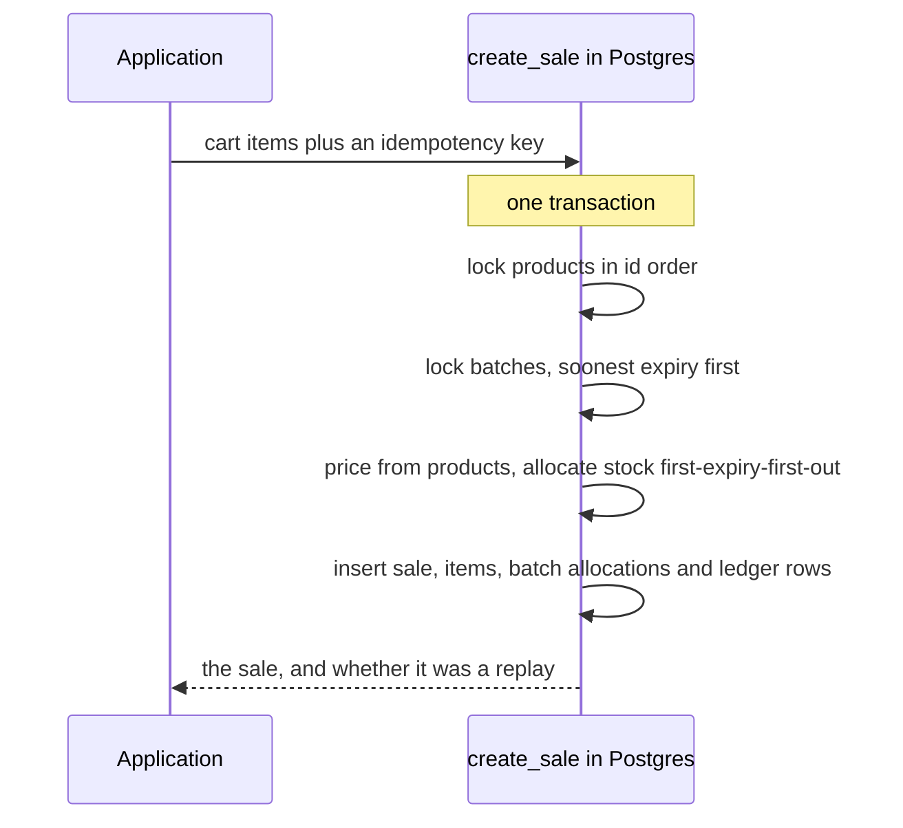
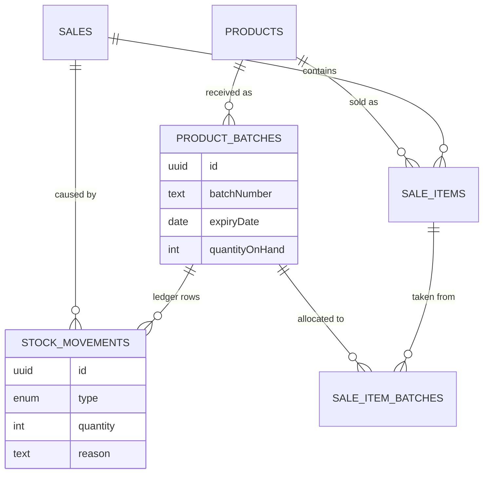

# Pharmacy stock ledger

A PostgreSQL reference implementation of **pharmacy stock control** that cannot oversell, cannot sell expired
stock, cannot be double-charged by a retry, and keeps a history nobody can rewrite.

It is extracted from a pharmacy point-of-sale system under development. This repository holds only the
database core (schema, functions, triggers, row-level security) and the tests that prove it, with synthetic
data. There is no UI and no payment integration.

## The problem

A naive checkout reads the stock, checks it, inserts the sale and writes the new number, as separate calls.
With two cashiers, a timeout and a retry, or a pharmacist editing a figure, that gives you:

- the same last box sold twice,
- a sale recorded with no stock change,
- a customer charged twice,
- expired medicine sold because expiry was "a column on the product",
- a stock number that no log can explain.

This repo fixes those in the database, where concurrent requests cannot interleave.

## See it work

Needs only PostgreSQL 15+. With Docker:

```bash
docker run -d --name pg -e POSTGRES_PASSWORD=pw -p 5432:5432 postgres:16
PGHOST=127.0.0.1 PGUSER=postgres PGPASSWORD=pw bash scripts/demo.sh
```

The demo signs in as a pharmacist and a cashier (real roles, real row-level security) and walks through
the guarantees. Real output, trimmed (dates and sale numbers vary by run):

```text
== 2. The cashier sells 120 units. Stock is taken from the batch expiring soonest
+-------------------+--------+----------+-------+
|       sale        | total  |  batch   | taken |
+-------------------+--------+----------+-------+
| POS-20261117-0001 | 360.00 | PCM-SOON | 50    |
| POS-20261117-0001 | 360.00 | PCM-LATE | 70    |
+-------------------+--------+----------+-------+

== 3. The same request is retried (a network timeout, say). Same sale, no second charge
+-------------------+----------+
|       sale        | replayed |
+-------------------+----------+
| POS-20261117-0001 | true     |
+-------------------+----------+

+----------+---------+
|  batch   | on_hand |
+----------+---------+
| PCM-SOON |       0 |
| PCM-LATE |      30 |
+----------+---------+

== 4. Things that must fail
-- selling more than exists:
ERROR:  INSUFFICIENT_STOCK|Paracetamol 500mg|30
-- the cashier trying to void a sale:
ERROR:  FORBIDDEN
-- the pharmacist hand-editing stock (editing a price is fine, stock is not):
ERROR:  STOCK_LEDGER_ONLY
-- rewriting the ledger:
ERROR:  permission denied for table stock_movements

== 5. The pharmacist voids the sale. Stock returns to the SAME batches, exactly once
+--------+
| status |
+--------+
| VOIDED |
+--------+

+----------+---------+
|  batch   | on_hand |
+----------+---------+
| PCM-SOON |      50 |
| PCM-LATE |     100 |
+----------+---------+

== 7. Integrity check: recompute everything from the ledger (0 = consistent)
+------------+
| mismatches |
+------------+
|          0 |
+------------+
```

## Guarantees and where each one is tested

| Guarantee | How | Test (`tests/harness.py`) |
|---|---|---|
| Never sell more than exists | Row locks taken before the stock check, in a fixed order | 1: 300 concurrent sales on 100 units across 3 batches sell exactly 100 |
| Expiring stock sells first; expired stock never sells | First-expiry-first-out allocation across batches, expired batches skipped | 2: allocation order, expired batch untouched |
| A retry never double-charges | Idempotency key per user, concurrent retries serialised | 4: 25 parallel retries make one sale and one stock change |
| A void returns stock once, to the same batches | Sale row locked; per-line batch allocations recorded | 3: 10 concurrent voids, one succeeds |
| Prices cannot be tampered with | Price read from `products`; a client price is ignored | 4 |
| Stock cannot be edited around the ledger | Trigger refuses API writes to cached quantities; no write policies on sales | 5 |
| History cannot be rewritten | Ledger rows are immutable, even for a superuser | 5 |
| Carts that overlap never deadlock | One global lock order: products, then batches by expiry | 8: 250 opposite-order multi-batch carts |
| Failures leave no trace | One transaction per sale | 9 |
| The numbers add up | `verify_stock_integrity()` recomputes ledger, batches and products | 10 and 11 |

Test 10 is a randomised concurrent mix of sales, receipts, damage write-offs and voids. It ends by
checking that the ledger, the batch balances and the product totals agree, and that for every product
*initial stock + received = on hand + sold*.

**84 checks, all passing** on PostgreSQL 16. Run them with `bash scripts/run_tests.sh`; the GitHub Actions
workflow in `.github/workflows/ci.yml` runs them on every push.

## How it works





`products."stockQuantity"` and `product_batches."quantityOnHand"` are **caches** of the ledger. A trigger
updates them in the same transaction as every ledger row, and API roles cannot write them.

Every change to stock is one row in `stock_movements`: `RECEIPT`, `SALE`, `SALE_VOID`, `DAMAGE`,
`EXPIRY_WRITEOFF`, `RETURN_TO_SUPPLIER`, `CORRECTION` or `OPENING`. A database constraint ties the sign to the
type (a `SALE` must be negative, a `RECEIPT` positive).

## Design decisions

Each has a written record with the problem, the alternatives considered and the trade-offs:

- [ADR 0001: checkout and void as Postgres functions](docs/adr/0001-atomic-checkout-in-the-database.md)
- [ADR 0002: a stock ledger over batches, first-expiry-first-out](docs/adr/0002-stock-ledger-and-batches.md)

## Repository layout

```
db/migrations/
  001_core_schema.sql              users, products, suppliers, sales, row-level security
  002_stock_ledger_and_batches.sql ledger, batches, triggers, receive/adjust, integrity check
  003_checkout.sql                 create_sale and void_sale
db/seed/demo_seed.sql              synthetic demo data
db/test-support/stub_auth.sql      fakes Supabase's auth schema on a plain Postgres
tests/harness.py                   the concurrency and correctness suite
demo/walkthrough.sql               the guided tour above
scripts/                           run_tests.sh, demo.sh
docs/adr/                          architecture decision records
```

## Using it

It is written for **Supabase**: it relies on `auth.uid()` and the `anon` / `authenticated` roles. Apply the
three migrations in order (for example with `supabase db push`) and do **not** apply `stub_auth.sql`, which only
exists so the same SQL runs on a plain PostgreSQL for the tests and demo. The application calls the functions
through `rpc`:

| Function | Who | Purpose |
|---|---|---|
| `receive_stock(product, qty, batch_no, expiry, ...)` | admin, pharmacist | goods in; creates or tops up a batch |
| `adjust_stock(batch, delta, type, reason, ...)` | admin, pharmacist | damage, expiry write-off, supplier return, count correction |
| `create_sale(items, payment_method, discount, notes, idempotency_key)` | any signed-in user | checkout |
| `void_sale(sale, reason)` | admin, pharmacist | void and return stock |
| `verify_stock_integrity()` | admin, pharmacist | list any mismatch between ledger and cached totals |

## Limits

- **Single pharmacy.** There is no tenant model. All sales of a day briefly serialise on one counter row.
- **Payments are not verified.** The payment method is recorded, not checked against a payment provider.
- **Time zone** is `Africa/Accra`, set inside the functions. Change it there for another zone.
- **A superuser or the service role can bypass** the guard on the cached columns. That is deliberate for
  repairs, and `verify_stock_integrity()` detects it. The ledger itself stays immutable.
- **No UI and no authentication code.** Those live in the application that uses this.

## Roadmap

- Offline-tolerant selling: a local queue, idempotent sync, explicit conflict rules for stock.
- Multi-pharmacy tenancy with row-level security by membership.
- A verified mobile-money payment flow built on the same ledger.
