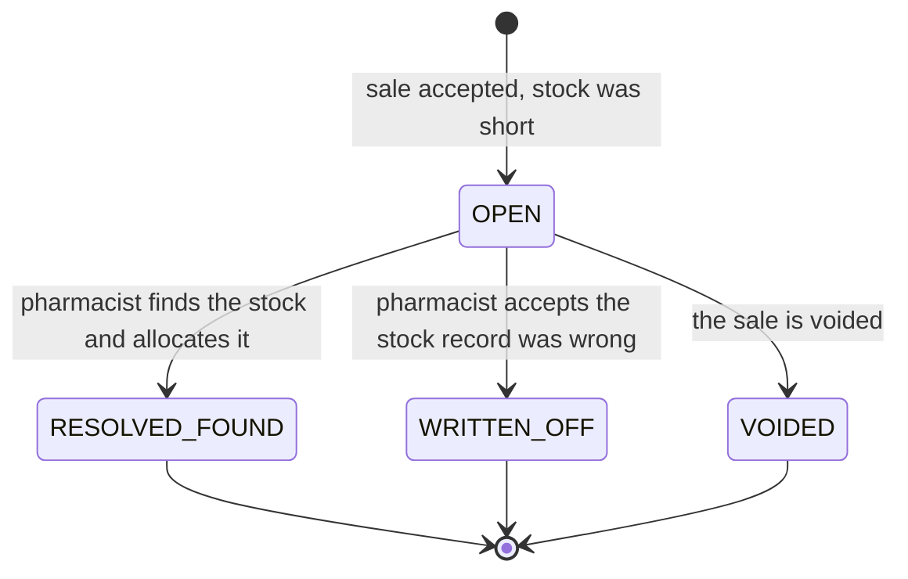
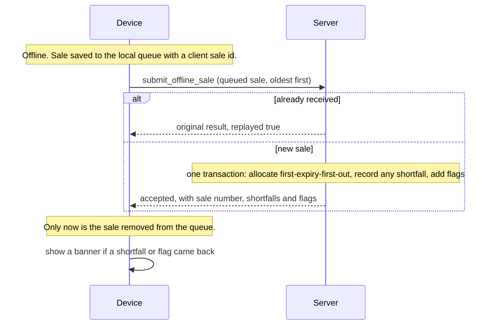

# ADR 0003: Offline selling

- Status: **accepted**. Implemented in `db/migrations/004_offline_sales.sql` and tested in `tests/offline_harness.py`.
- Builds on: ADR 0001 (atomic, idempotent checkout) and ADR 0002 (stock ledger over batches)

## Context

A pharmacy cannot stop selling when the internet drops. A till that goes offline keeps selling, queues each
sale locally, and sends the queue when the connection returns. Three things then go wrong that online checkout
never has to face:

1. **The same sale arrives more than once, late, or out of order.** Networks retry, apps restart mid-sync, and
   two devices may report overlapping stock.
2. **The sale already happened.** The customer has the medicine and the receipt. By the time the sale reaches
   the server, the ledger may say the stock is not there.
3. **The device is not trustworthy.** Its clock can be wrong, its price list can be stale, and its user may
   have been removed since.

Online, the server decides before the sale happens, so it can refuse. Offline it can only decide afterwards.
That changes the question from "should this sale be allowed?" to "how do we record what already happened
without breaking the ledger?"

## Principles

1. **The physical event wins.** A sale that happened is recorded. It is never silently dropped.
2. **The ledger never goes negative and is never rewritten.** The invariants from ADR 0002 hold at all times.
3. **Every divergence becomes a visible, resolvable record.** Nothing is smoothed over; a pharmacist sees it
   and decides.
4. **The device never deletes a queued sale until the server has acknowledged it.**

## Decision

Offline sales are submitted to a new function, `submit_offline_sale`, that shares its stock-allocation logic
with `create_sale` but applies a different policy: where `create_sale` rejects a shortage, the offline path
**accepts the sale, allocates what exists, and records the shortage as an open shortfall**.

### Rules

| Situation | Rule | Why |
|---|---|---|
| The same sale arrives again | Return the original result. Keyed by `(deviceId, clientSaleId)`, where `clientSaleId` is a UUID the device creates before showing the receipt and stores with the queued sale | Retries and restarts must be harmless |
| Sales arrive out of order | Process each as an independent transaction. Stock decrements commute, so the order does not change the final stock | Only the non-negative rule can conflict, not the order |
| Stock is short at sync time | Allocate what exists first-expiry-first-out. Record the missing quantity in `sale_shortfalls` with status `OPEN`. The sale is still `COMPLETED` | Rule 1 and rule 2 together |
| Only expired stock remains | Treat the same as a shortage: the goods handed over were not the expired ones, so the record is stale | Expired stock is never sold (ADR 0002) |
| The price on the device differs from the server's | Record the price the customer paid and attach a `PRICE_MISMATCH` flag | The money collected is the fact; tampering stays visible and attributable |
| The payment method is not cash | Reject with `OFFLINE_CASH_ONLY`. The device keeps the sale queued and cannot print it as paid | Mobile money and card cannot be verified offline |
| The device clock is far from the server's | Store both `occurredAt` (device) and `receivedAt` (server). Flag `CLOCK_SKEW` beyond a tolerance. Reports use `receivedAt` for money and `occurredAt` for display | A device clock cannot be trusted for ordering or accounting |
| The sale is older than the offline window | Accept and flag `LONG_OFFLINE` | A long outage is an operational problem, not a reason to lose a sale |
| The device or its user was revoked before the sale | If `occurredAt` is after `revokedAt`, reject with `DEVICE_REVOKED`; the sale stays queued for manual review. Otherwise accept | Access removed in advance should not authorize new sales |
| Receipt numbers | The device prints `OFF-<device>-<n>`. The server assigns the real sale number at sync and stores the device number as `clientReceiptNumber` | A receipt must exist before the server does |

### Shortfall lifecycle

- **RESOLVED_FOUND** inserts a `SALE` ledger row for the missing quantity from a batch the pharmacist chooses,
  and a `sale_item_batches` row, so a later void returns it correctly. If the chosen batch holds fewer units than
  the shortfall, a `CORRECTION` for the difference is recorded first, because the stock was found.
- **WRITTEN_OFF** inserts no stock movement. It records that the ledger had overstated stock and the sale stands.
  A reason is required.
- **VOIDED** happens when `void_sale` runs on the sale. Allocated stock returns; the shortfall closes.

### New invariant

For every sale line: `sale_items.quantity = (sum of its batch allocations) + (sum of its shortfalls that are not
RESOLVED_FOUND)`. A resolved-found shortfall has moved into the allocations, so it is not counted twice.
`verify_stock_integrity()` is extended to report any line where that does not hold. The existing ledger
invariants are unchanged.

### Data model additions

| Addition | Purpose |
|---|---|
| `devices (id, userId, name, registeredAt, revokedAt)` | Identifies each till and supports revocation |
| `sales.source` (`ONLINE` or `OFFLINE`), `deviceId`, `clientSaleId`, `clientReceiptNumber`, `occurredAt`, `receivedAt`; unique `(deviceId, clientSaleId)` | Idempotency and audit |
| `sale_shortfalls (id, saleItemId, productId, quantity, status, resolution, resolvedBy, openedAt, resolvedAt)` | The open work for a pharmacist |
| `sale_flags (saleId, code, detail, createdAt)` | `PRICE_MISMATCH`, `CLOCK_SKEW`, `LONG_OFFLINE` |
| `resolve_shortfall(...)` | Pharmacist-only; moves a shortfall out of `OPEN` |

### Sync protocol

### Client contract

The device keeps a local outbox. Each queued sale moves through `PENDING`, `SENDING`, then `SYNCED` (removed)
or `REJECTED` (kept, needs a person). A sale is written to the outbox before the receipt is shown, so a crash
cannot lose it. The device sends the oldest first and retries with backoff. It keeps a stock snapshot with an
`asOf` time to warn the cashier, and it warns but does not block, because the shelf is the truth.

## Alternatives considered

1. **Reject the sale when stock is short.** Simple, but the medicine is already gone. The record would say it
   never happened, and the money collected has no sale to attach to.
2. **Allow negative stock.** Breaks the ledger's central guarantee and makes every report ambiguous.
3. **Give each device a stock quota to sell offline.** Guarantees no shortage, but strands stock on one till
   while another runs out. It makes more sense for many tills than for one or two per pharmacy.
4. **Last-write-wins or a CRDT for stock.** Stock decrements already commute, so there is nothing to merge.
   The real conflict is the non-negative rule, which needs a business decision, not a merge function.

## Consequences

- Allocation order is decided at sync time, not by what was physically handed over, so batch tracing for
  offline sales is weaker than for online ones. A device that scans the batch would fix this later.
- The shortfall queue is new operational work for a pharmacist. The repo shows it and the pharmacy has to act on it.
- Offline selling is cash only until a verified payment flow exists.

## Tests this design requires

| Scenario | Expected result |
|---|---|
| One sale submitted 20 times in parallel | One sale; stock moves once |
| A queue replayed in reverse order | Same final stock as in order |
| Sale of 5 when 3 exist | Sale accepted; 3 allocated; one open shortfall of 2; stock never negative |
| Only expired stock remains | Sale accepted; whole quantity becomes a shortfall |
| Each shortfall resolution path | Resolved found, written off or voided; the line invariant still holds |
| Void of a sale with an open shortfall | Allocated stock returns; shortfall closes as `VOIDED` |
| Non-cash payment | Rejected with `OFFLINE_CASH_ONLY` |
| Price differs from the server's | Accepted at the device price; `PRICE_MISMATCH` flagged |
| Device clock hours ahead or behind | Accepted; `CLOCK_SKEW` flagged |
| Sale after the device was revoked | Rejected with `DEVICE_REVOKED` |
| Random mix of devices, duplicates, replays and resolutions | Ledger, batch and product totals agree; every line satisfies the invariant |

## Decisions

Confirmed by the owner:

1. **Oversell policy:** accept the sale and record a shortfall.
2. **Payments offline:** cash only.
3. **Price mismatch:** record the price paid and flag it.
4. **Long offline sales:** accept and flag them.

## Implementation notes

- `allocate_stock` is the one allocator. `create_sale` calls it and refuses a shortage; `submit_offline_sale` calls
  it and records one. The refactor of `create_sale` changed no behaviour: the existing 84 checks pass unchanged.
- Thresholds are constants in `submit_offline_sale`: a device clock more than **15 minutes** ahead of the server is
  `CLOCK_SKEW`; a sale older than **72 hours** is `LONG_OFFLINE`.
- Devices are registered and revoked by staff (`register_device`, `revoke_device`). A sale is rejected with
  `DEVICE_REVOKED` only if `occurredAt` is after the revocation, and a replay of an already accepted sale always
  returns the original.
- Removing a user means they cannot submit (`FORBIDDEN`). The `users` table has no deactivation flag yet.
- Lines for the same product must carry one price; the same product at two prices in one sale is rejected,
  because the allocator would run twice before stock is updated.
- A product that has since been deactivated is still accepted offline: the sale already happened.
- The sale number is assigned by the server at sync. The device's own receipt number is stored as
  `clientReceiptNumber`.
